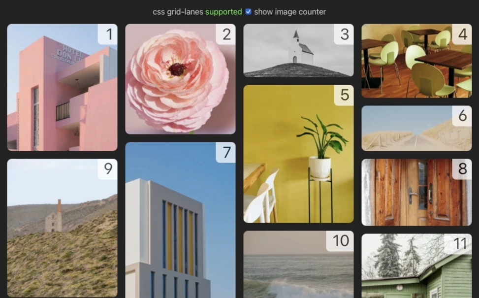
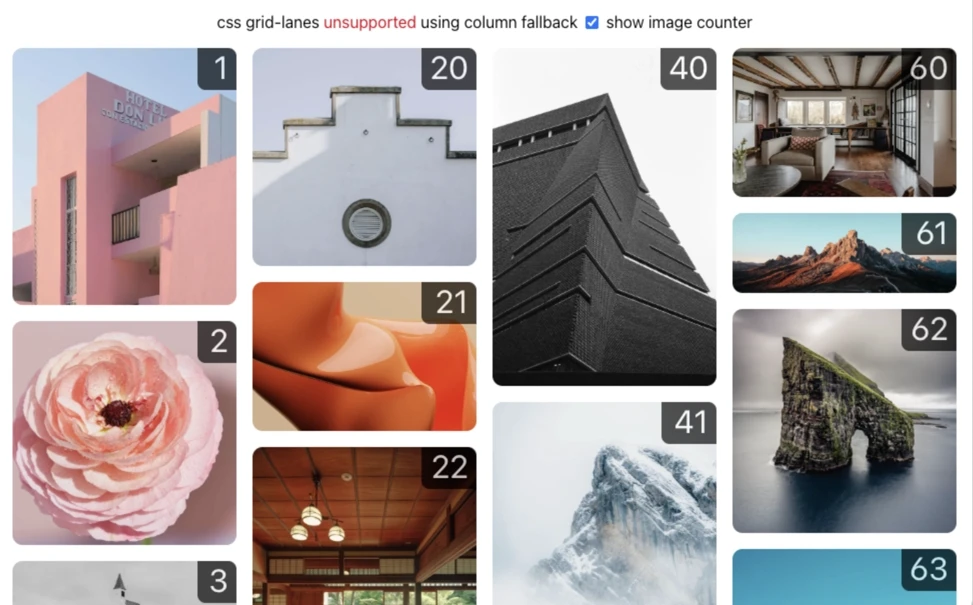

# CSS grid-lanes with column fallback

[Shows](https://elardus3.github.io/grid-lanes-fallback-column/) a masonry or waterfall type
layout with dynamic element heights.

As on October 2026 only Safari supports grid-lanes.

A column layout fallback is shown for unsupported browsers. The drawback is that the content is
ordered in columns from left to right instead of top-down waterfall. But visual layout seems
improved compared to flexbox and grid fallbacks.

See alternative [flexbox](https://github.com/elardus3/grid-lanes-fallback-flexbox/)
and [grid](https://github.com/elardus3/grid-lanes-fallback-grid/) layout fallbacks.
